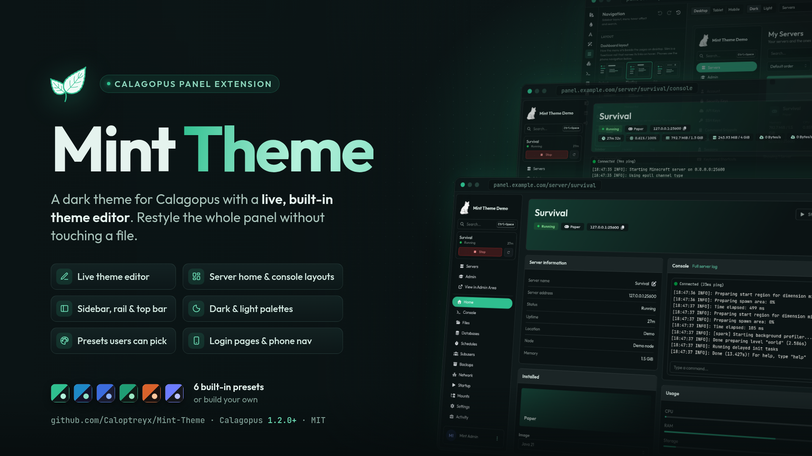
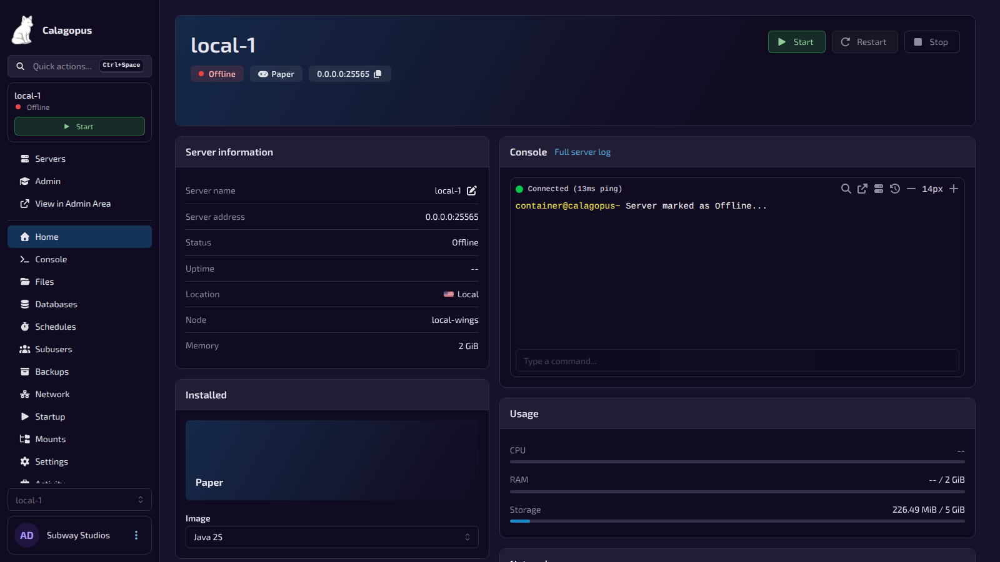
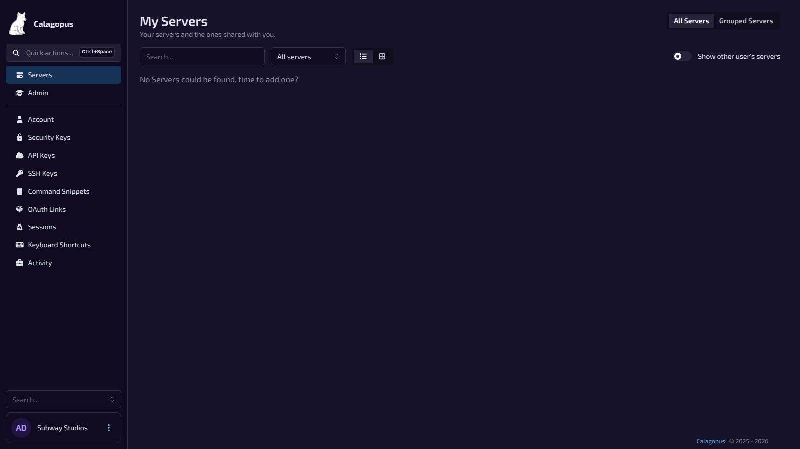
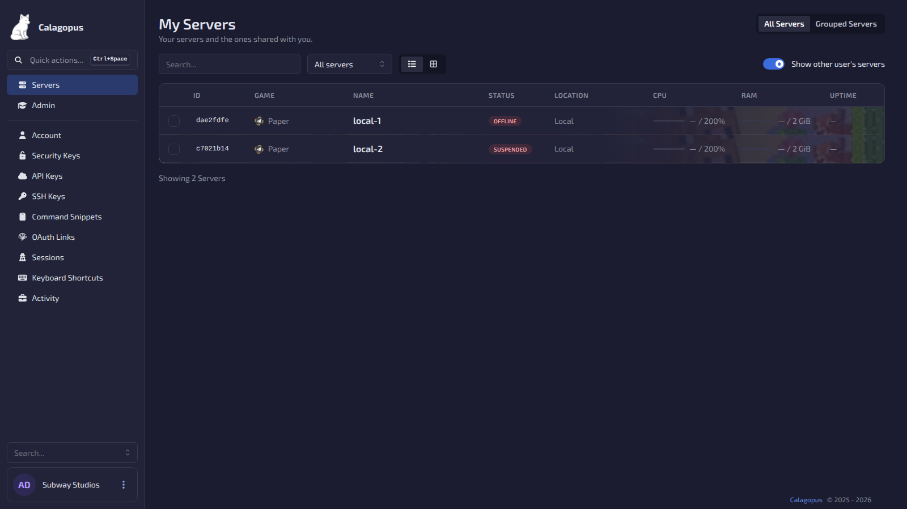
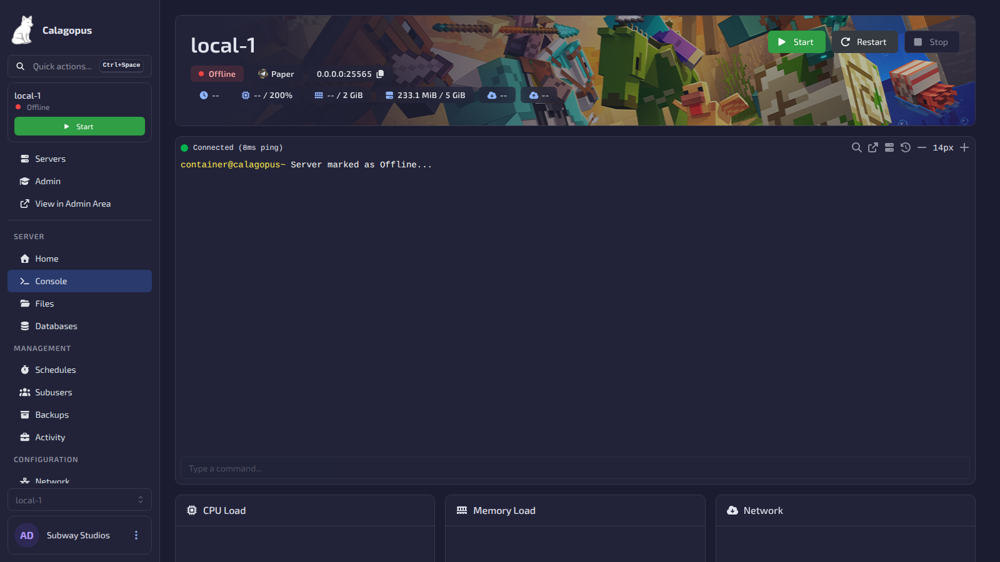
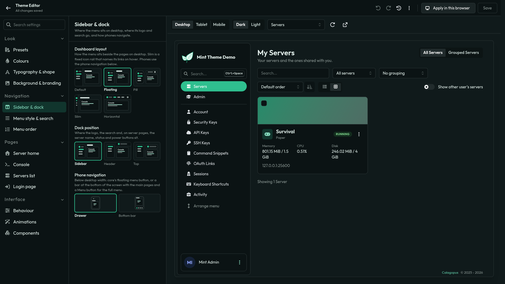

<h1>
  <picture>
    <source media="(prefers-color-scheme: dark)" srcset="docs/logo-dark.svg">
    
  </picture>
</h1>

A dark theme for [Calagopus Panel](https://calagopus.com) with a live, built-in theme editor.

## Features

- **Server list:** table or grid views with search, status filters, sorting, grouping, responsive columns, game artwork, selectable servers, and bulk start/restart/stop actions. Several card and table styles are included.
- **Server home:** configurable banner, power controls, server information, image switcher, console preview, usage, network and card order. It can be disabled to keep the console as the first page.
- **Console:** configurable presets and layouts for the banner, stats, server info, usage rings, quick commands, connection details, charts and extension cards. The terminal supports glass or borderless styling, full-window mode, variable height, cursor styles and custom line height. Charts support area/line styles, multiple heights and layouts.
- **Navigation:** collapsible sections, menu ordering per user, admin menu ordering, desktop sidebar/header/top-bar layouts, link styles, quick actions, server/user search and phone bottom navigation.
- **Mobile:** responsive server tables and a phone-friendly Monaco editor with wrapping, a larger font, hidden minimap/popups and an extra keyboard toolbar.
- **Account and announcements:** user-uploaded profile banners and avatars, plus optional call-to-action buttons on announcements.
- **Login pages:** multiple card, banner and split layouts, custom logo/background and support links.
- **Appearance:** dark and light palettes, custom fonts, monospace code font, background images, artwork per game, browser icon, card/stat/table styles, glass effects, borders, radius and button styles.
- **Animations:** configurable page, card, row, hover, click, dialog and menu animations with speed controls and a global motion switch. Reduced-motion devices are respected.
- **Theme editor:** live preview of the real panel in either mode, searchable settings, presets, undo/redo, import/export, contrast warnings, validation, resizable settings panel, home layout controls and unsaved-change protection.
- **Themes and permissions:** save up to 20 personal presets, choose built-in or saved presets on the account page, restore the last 10 saved themes, or apply a draft only in the current browser. Saving requires Settings update or Mint theme → Update permission.
- **Languages:** English, Arabic, Chinese, Danish, French, German, Italian, Japanese, Latvian, Polish, Portuguese, Romanian, Russian, Slovak, Spanish, Swedish, Turkish and Vietnamese.

## Screenshots

| Server list | Grid view |
| --- | --- |
|  |  |

| Console | Theme editor |
| --- | --- |
|  |  |

## Demo

Try the demo at https://mintdemo.caloptreyx.com. It resets hourly and saving is disabled.

## Installation

> [!NOTE]
> Requires Calagopus Panel **1.2.0** or newer.

1. Download `dev_caloptreyx_mint.c7s.zip` from the [latest release](https://github.com/Caloptreyx/Mint-Theme/releases/latest).
2. In the panel, open **Admin → Extensions** and install the file.
3. Restart the panel.

The extension is **Mint Theme** (`dev.caloptreyx.mint`); new releases appear under **Admin → Updates**.

> [!IMPORTANT]
> Upgrading from 1.2.1 or older requires removing the old `dev.s4way.nebula` extension, installing the new zip and rebuilding once. Saved themes and announcement buttons carry over.

## Usage

Open **Admin → Theme Editor** to preview changes and save them for all users, including the login page. To add an announcement button, open **Admin → Announcements**, select an announcement and use its **Call to Action** tab.

Mint changes the panel at runtime and does not override core files; disabling it restores the stock panel.

## Support and contributing

For help or feature requests, join the [Caloptreyx Discord](https://discord.gg/4qjMWU7S8x). See [AGENTS.md](AGENTS.md) for build, integration and testing guidance.

## License

Code is [MIT](LICENSE). Bundled fonts (Exo 2, Montserrat, Outfit, Plus Jakarta Sans, Space Grotesk, JetBrains Mono and Fira Code) use the SIL Open Font License 1.1; their licence texts are in [`frontend/src/fonts`](frontend/src/fonts).
